# The Wired Expansion — GNS3 (VLSM)

Laporan Praktikum Modul 4 Komdat Jarkom 2026, kelompok **K-46**. Subnetting pada GNS3 menggunakan **VLSM**. Bagian Cisco Packet Tracer menggunakan **CIDR**. [Laporan Packet Tracer](../cpt-cidr/README.md)

| Item | Keterangan |
|---|---|
| Project GNS3 | `K-46-MODUL-4` |
| Prefix IP | `192.234` |
| Blok induk | `192.234.0.0/19` (`255.255.224.0`) |
| Jumlah subnet | 25 (A1–A25) |
| Kebutuhan IP | 2.814 IP host dan interface router |
| Total ukuran blok subnet | 4.188 alamat, termasuk Network ID dan broadcast |
| Routing | Static routing dengan IPv4 forwarding pada router |

## Topologi

Topologi terdiri dari **52 perangkat dan 51 kabel**. Perangkatnya terdiri dari 13 router, 13 switch, 25 node host, dan 1 NAT. NAT1 terhubung langsung ke Cyberia. Setiap node host di GNS3 mendapat satu IP untuk mewakili kelompok host yang tertera pada gambar soal. [Gambar topologi soal](https://drive.google.com/file/d/1B_O8eiCmmFBcvyT-J5YCsoAIxY28Wwj-/view)

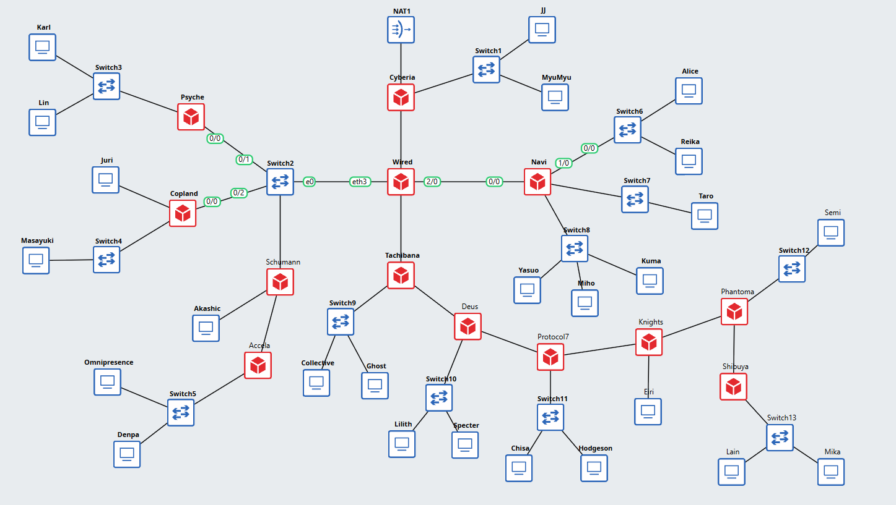

## Perhitungan VLSM

Kebutuhan IP suatu subnet dihitung dari jumlah host pada gambar ditambah jumlah interface router yang terhubung ke subnet tersebut. Port switch pada topologi ini tidak diberi IP. Contohnya, A6 membutuhkan `700 (Karl) + 180 (Lin) + 1 (Psyche) = 881 IP`. Setelah menambah dua alamat untuk Network ID dan broadcast, kebutuhan bloknya menjadi 883 alamat. Pangkat dua terkecil yang memenuhi kebutuhan itu adalah `2^10 = 1.024`, sehingga prefix A6 adalah `32 − 10 = /22`.

Pembagian dimulai dari blok terbesar. A6 mendapat `192.234.0.0/22` dengan broadcast `192.234.3.255`. A11 mendapat blok berikutnya mulai `192.234.4.0/22`. Keduanya merupakan dua bagian dari `192.234.0.0/21`. Di spreadsheet, hasil pembagian ditampilkan menurut nomor subnet A1–A25. [Tabel kebutuhan IP](https://docs.google.com/spreadsheets/d/1rVodUBcBINJPgOZ-5xVqw0H3jL9A58Wp/edit?gid=1199523220#gid=1199523220) · [Tabel pembagian IP VLSM](https://docs.google.com/spreadsheets/d/1rVodUBcBINJPgOZ-5xVqw0H3jL9A58Wp/edit?gid=916994593#gid=916994593)

| Subnet | Jumlah IP | Network/prefix |
|---|---:|---|
| A1 | 126 | `192.234.14.0/25` |
| A2 | 2 | `192.234.16.56/30` |
| A3 | 4 | `192.234.16.32/29` |
| A4 | 2 | `192.234.16.60/30` |
| A5 | 2 | `192.234.16.64/30` |
| A6 | 881 | `192.234.0.0/22` |
| A7 | 32 | `192.234.15.192/26` |
| A8 | 301 | `192.234.8.0/23` |
| A9 | 4 | `192.234.16.40/29` |
| A10 | 2 | `192.234.16.68/30` |
| A11 | 514 | `192.234.4.0/22` |
| A12 | 254 | `192.234.12.0/24` |
| A13 | 58 | `192.234.15.64/26` |
| A14 | 143 | `192.234.13.0/24` |
| A15 | 267 | `192.234.10.0/23` |
| A16 | 2 | `192.234.16.72/30` |
| A17 | 99 | `192.234.14.128/25` |
| A18 | 2 | `192.234.16.76/30` |
| A19 | 33 | `192.234.15.128/26` |
| A20 | 2 | `192.234.16.80/30` |
| A21 | 3 | `192.234.16.48/29` |
| A22 | 2 | `192.234.16.84/30` |
| A23 | 15 | `192.234.16.0/27` |
| A24 | 2 | `192.234.16.88/30` |
| A25 | 62 | `192.234.15.0/26` |

## Routing

Host menggunakan IP router di subnetnya sebagai gateway. JJ (`192.234.14.2`) memakai Cyberia (`192.234.14.1`) di A1. Mika (`192.234.15.3`) memakai Shibuya (`192.234.15.1`) di A25. Untuk komunikasi lintas subnet, router mengaktifkan IPv4 forwarding dan menggunakan static route ke jaringan tujuan. Jalur balik juga harus tersedia.

## Cara menguji

1. Buka console **Cyberia**, **Wired**, dan **Tachibana** satu per satu, lalu jalankan `ip route` untuk melihat rute aktif dan next hop masing-masing.
2. Buka console **JJ**, lalu jalankan `ping -c 3 192.234.15.3`.
3. Buka console **Mika**, lalu jalankan `ping -c 3 192.234.14.2`.
4. Cek jumlah balasan dan persentase packet loss untuk kedua arah. Jika muncul `Destination Net Unreachable`, gunakan `ip route get <IP tujuan>` pada gateway yang mengirim pesan itu untuk memeriksa rutenya.

## Hasil pengujian

### Ping internal setelah konfigurasi routing

Ping antara A1 dan A25 berhasil dua arah untuk pasangan JJ dan Mika serta Lain dan JJ.

| Arah | Perintah di perangkat sumber | Paket diterima | Packet loss |
|---|---|---:|---:|
| JJ → Mika | `ping -c 3 192.234.15.3` | 3 dari 3 | 0% |
| Mika → JJ | `ping -c 3 192.234.14.2` | 3 dari 3 | 0% |
| Lain → JJ | `ping -c 3 192.234.14.2` | 3 dari 3 | 0% |
| JJ → Lain | `ping -c 3 192.234.15.2` | 3 dari 3 | 0% |

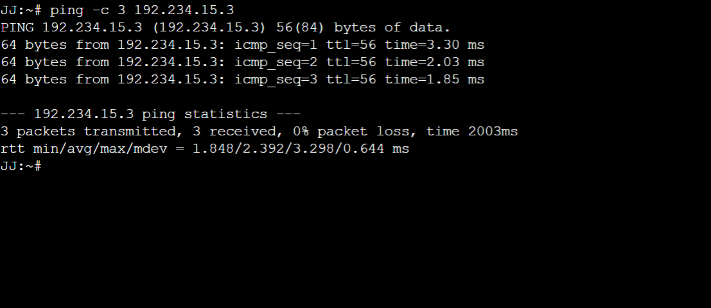

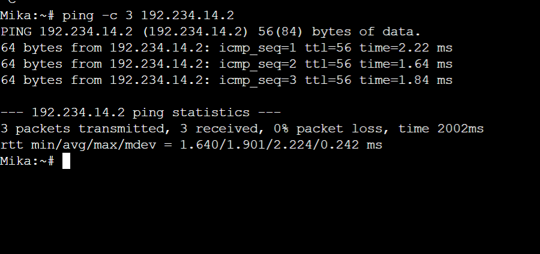

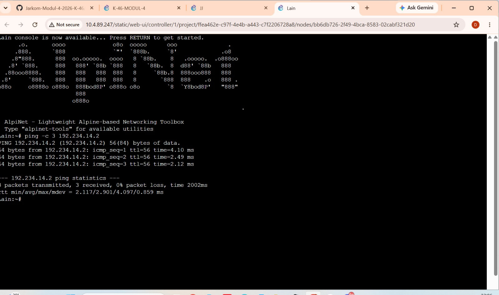

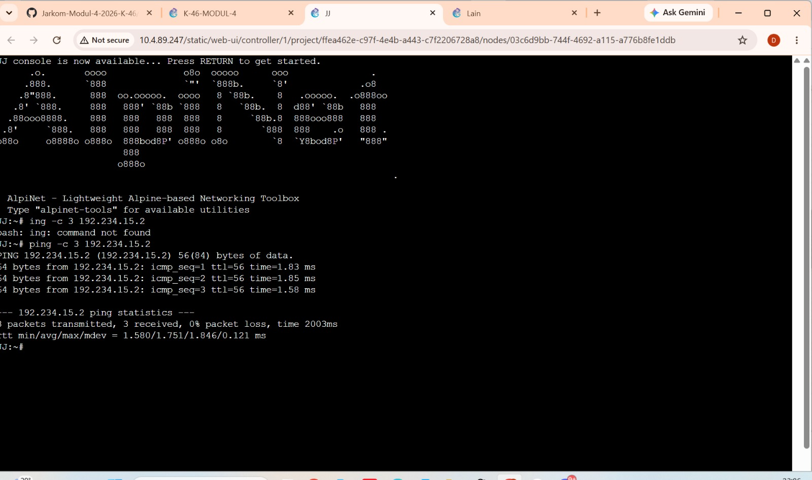

Diagnosis awal sebelum konfigurasi routing

### Ping awal antar-subnet

| Sumber | Tujuan | Hasil di screenshot |
|---|---|---|
| JJ (`192.234.14.2`) | Mika (`192.234.15.3`) | `Destination Net Unreachable` dari Cyberia (`192.234.14.1`). 0 dari 3 paket diterima. |
| Mika (`192.234.15.3`) | JJ (`192.234.14.2`) | `Destination Net Unreachable` dari Shibuya (`192.234.15.1`). 0 dari 3 paket diterima. |

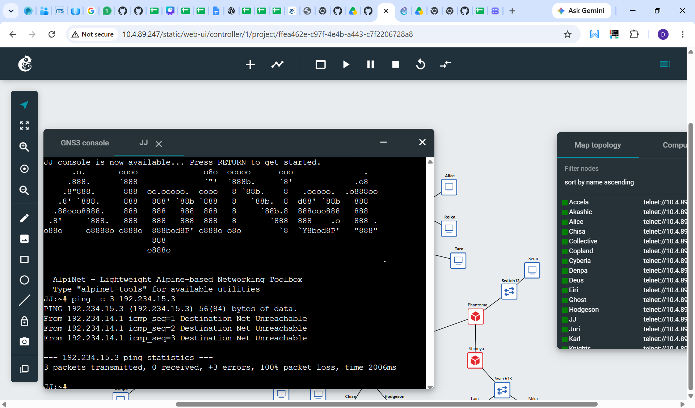

### Pemeriksaan gateway sebelum penambahan rute

Di kedua gateway, `/proc/sys/net/ipv4/ip_forward` bernilai `1`, tetapi `ip route get` ke alamat host tujuan menampilkan `Network is unreachable`. Jadi forwarding sudah aktif dan tabel routing belum punya jalur ke tujuan yang diuji.

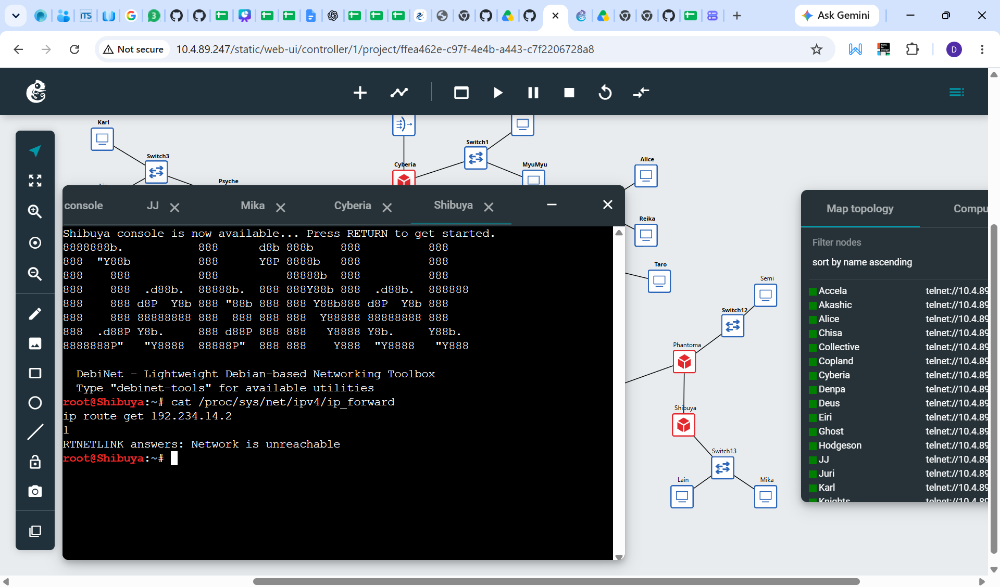

### Pemeriksaan gateway setelah penambahan rute

| Router | Rute yang dipasang pada screenshot | Hasil `ip route get` |
|---|---|---|
| Cyberia | `192.234.0.0/20 via 192.234.16.58 dev eth2` | Tujuan `192.234.15.3` keluar melalui `eth2` menuju `192.234.16.58` (Wired). |
| Shibuya | `default via 192.234.16.89 dev eth0` | Tujuan `192.234.14.2` keluar melalui `eth0` menuju `192.234.16.89` (Phantoma). |

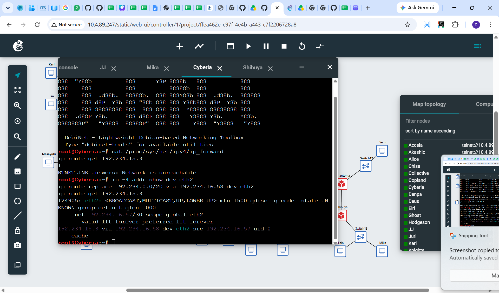

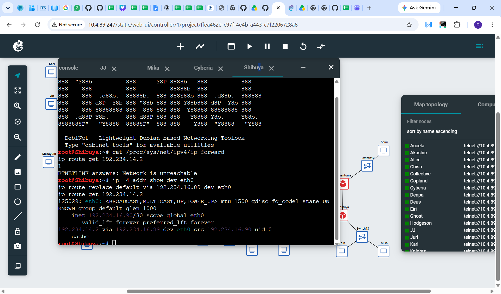

Kedua screenshot di atas menunjukkan next hop yang dipilih masing-masing gateway.

### Tabel routing Cyberia, Wired, dan Tachibana

Perintah `ip route` menampilkan rute internal yang aktif di tiga router. Baris `default` pada Wired dan Tachibana menunjukkan arah ke router induk. Baris dengan `via` menunjukkan router berikutnya untuk jaringan tujuan tertentu.

| Router | Default route | Contoh rute internal dari screenshot |
|---|---|---|
| Cyberia | Tidak tercantum pada hasil `ip route` ini. | `192.234.0.0/20 via 192.234.16.58 dev eth2` menuju Wired. |
| Wired | `default via 192.234.16.57 dev eth0` menuju Cyberia. | `192.234.12.0/23 via 192.234.16.62 dev eth2` merangkum dua subnet LAN di cabang Navi. |
| Tachibana | `default via 192.234.16.65 dev eth0` menuju Wired. | `192.234.15.0/26 via 192.234.16.74 dev eth2` menuju subnet LAN Shibuya melalui Deus. |

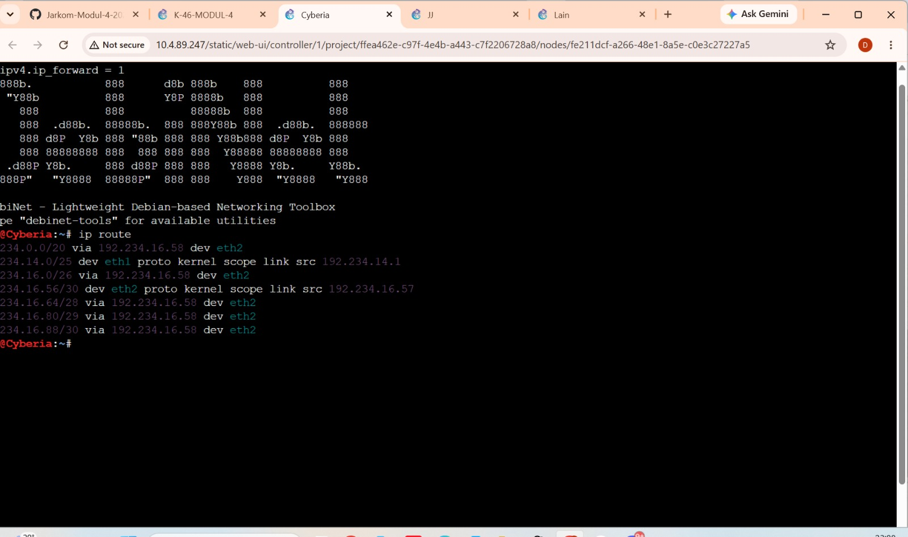

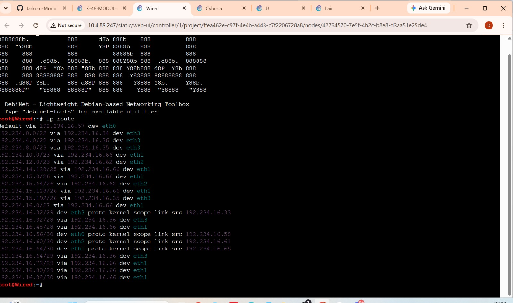

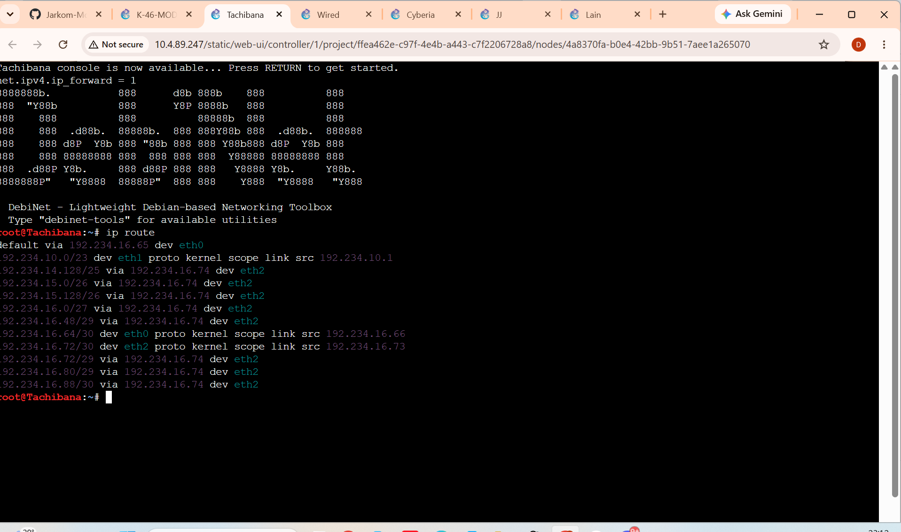

### Koneksi ke luar melalui NAT

Pada percobaan terakhir, `ping -c 3 8.8.8.8` dari Lain belum mendapat balasan. Uji koneksi luar ini dicatat terpisah dari ping internal.
